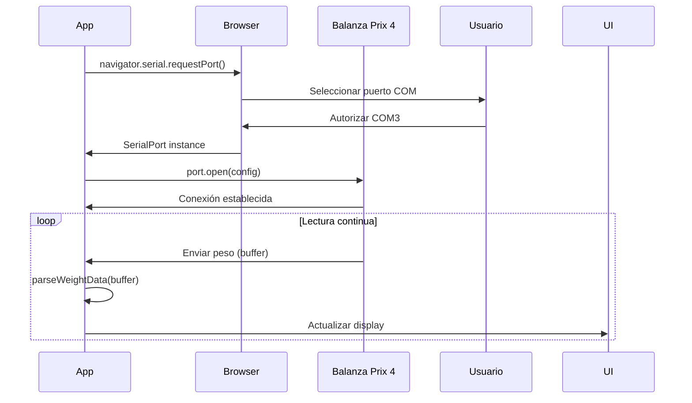

# PROTOCOLO BALANZA PRIX 4 - DOCUMENTACIÓN TÉCNICA

## Información General

**Modelo**: Prix 4  
**Fabricante**: (Verificar según tu modelo)  
**Tipo**: Balanza digital de precisión  
**Conexión**: Puerto Serial (RS-232/USB)

---

## Especificaciones Técnicas

### Configuración del Puerto Serial

```typescript
{
  baudRate: 9600,      // Velocidad de comunicación (bps)
  dataBits: 8,         // Bits de datos
  stopBits: 1,         // Bits de parada
  parity: 'none',      // Sin paridad
  flowControl: 'none'  // Sin control de flujo
}
```

### Capacidad

- **Peso Mínimo**: 5 gramos (0.005 kg)
- **Peso Máximo**: 5 kilogramos (configurable según modelo)
- **Precisión**: 3 decimales (0.001 kg)
- **Tara**: Sí, automática mediante software

---

## Formato de Datos

### Lecturas de Peso

La balanza Prix 4 envía datos continuamente por el puerto serial. El formato exacto puede variar, pero típicamente es:

#### Formato 1 (Más Común)
```
W   1.234 kg\r\n
```

#### Formato 2 (Simplificado)
```
   1.234\r\n
```

#### Formato 3 (Con Indicador de Estabilidad)
```
ST   1.234 kg\r\n
```

Donde:
- `W` = Weight (peso)
- `ST` = Stable (estable)
- `1.234` = Valor numérico del peso
- `kg` = Unidad de medida
- `\r\n` = Carriage return + Line feed (final de línea)

### Parser Implementado

Nuestro parser (`prix4-protocol.ts`) es flexible y soporta múltiples formatos:

```typescript
parseWeightData(buffer: ArrayBuffer): WeightReading | null
```

**Ejemplo de lectura**:
```typescript
{
  weight: 1.234,      // Peso en kg
  unit: 'kg',         // Unidad normalizada
  stable: true,       // ¿Peso estable?
  raw: 'ST 1.234 kg'  // Dato crudo recibido
}
```

---

## Comunicación vía Web Serial API

### Flujo de Conexión



### Código de Ejemplo

```typescript
import { SerialConnection } from '@/lib/scale/serial-connection';
import { parseWeightData } from '@/lib/scale/prix4-protocol';

// Crear conexión
const connection = new SerialConnection({
  baudRate: 9600,
  onData: (data: ArrayBuffer) => {
    const reading = parseWeightData(data);
    if (reading && reading.stable) {
      console.log(`Peso estable: ${reading.weight} kg`);
    }
  },
  onError: (error: Error) => {
    console.error('Error de balanza:', error.message);
  }
});

// Conectar
await connection.connect();

// Desconectar
await connection.disconnect();
```

---

##  Detección de Peso Estable

### Algoritmo

El sistema considera un peso **estable** cuando:

1. Recibe N lecturas consecutivas (por defecto: 3)
2. La variación entre lecturas es ≤ umbral (por defecto: 5g = 0.005kg)

```typescript
// Historial: [1.230, 1.232, 1.234]
// Diferencias: |1.230-1.232| = 0.002 ✅
//              |1.232-1.234| = 0.002 ✅
// RESULTADO: Estable (todas < 0.005)
```

### Configuración

```typescript
const { weight, isStable } = useScale({
  stabilityThreshold: 0.005,  // 5 gramos
  stabilityReadings: 3        // 3 lecturas consecutivas
});
```

---

## Manejo de Tara

### Concepto

La **tara** es el peso del recipiente (bowl, copa) que se resta automáticamente del peso bruto para obtener el peso neto del producto.

### Configuración

```sql
-- En tabla scale_configs
UPDATE scale_configs 
SET tara = 0.15  -- 150 gramos (bowl estándar)
WHERE branch_id = 'xxx';
```

### Cálculo

```typescript
Peso Neto = Peso Bruto - Tara

Ejemplo:
Peso Bruto = 1.234 kg (balanza muestra)
Tara = 0.150 kg (bowl vacío)
Peso Neto = 1.084 kg (producto real)
```

---

## Validaciones

### Rangos Permitidos

```typescript
const WEIGHT_LIMITS = {
  MIN: 0.005,  // 5 gramos mínimo
  MAX: 5.0     // 5 kg máximo
};
```

### Mensajes de Error

| Error | Causa | Mensaje |
|-------|-------|---------|
| Peso negativo | Tara mal configurada | "Peso negativo detectado. Verifica la tara de la balanza." |
| Peso muy bajo | < 5g | "Peso mínimo: 5g" |
| Peso excedido | > 5kg | "Peso máximo excedido: 5kg" |

---

## Troubleshooting

### Balanza no se conecta

**Síntomas**: Error al seleccionar puerto o conexión rechazada

**Soluciones**:
1. Verificar que la balanza está encendida
2. Revisar cable USB/Serial conectado
3. En Windows: Device Manager → Puertos COM → verificar que el puerto existe
4. Cerrar otras aplicaciones que puedan estar usando el puerto
5. Probar con otro puerto COM si hay múltiples

### Lecturas inestables

**Síntomas**: Peso fluctúa constantemente, nunca se marca como estable

**Soluciones**:
1. Colocar balanza en superficie plana y estable
2. Calibrar balanza según manual del fabricante
3. Aumentar `stabilityThreshold` en código (ej: 0.010 = 10g)
4. Aumentar `stabilityReadings` (ej: 5 lecturas)
5. Verificar que no haya vibración ambiental

### Datos corruptos

**Síntomas**: Parser retorna `null`, errores en consola

**Soluciones**:
1. Verificar `baudRate` coincide con configuración física de balanza
2. Revisar logs de `raw` data para entender formato real
3. Ajustar parser en `prix4-protocol.ts` según formato específico
4. Verificar integridad del cable

### Web Serial API no disponible

**Síntomas**: `serial` is undefined, error en navegador

**Soluciones**:
1. Usar Chrome/Edge 89+
2. Activar flag experimental: `chrome://flags/#enable-experimental-web-platform-features`
3. Implementar backend proxy (ver alternativa abajo)

---

## Alternativa: Backend Proxy

Si necesitas soporte para Firefox/Safari, implementa un servidor Node.js:

```typescript
// backend/scale-proxy.ts
import serialport from 'serialport';
import { WebSocketServer } from 'ws';

const port = new serialport('/dev/ttyUSB0', { baudRate: 9600 });
const wss = new WebSocketServer({ port: 8080 });

port.on('data', (data) => {
  wss.clients.forEach((client) => {
    client.send(data.toString());
  });
});
```

**Cliente**:
```typescript
const ws = new WebSocket('ws://localhost:8080');
ws.onmessage = (event) => {
  const reading = parseWeightData(event.data);
  // Procesar peso...
};
```

---

## Modo Mock para Desarrollo

Para desarrollo sin hardware físico:

```bash
# .env.local
NEXT_PUBLIC_MOCK_SCALE=true
```

Esto activa lecturas simuladas con pesos aleatorios entre 0.5-2.0 kg.

---

## Referencias

- [Web Serial API - MDN](https://developer.mozilla.org/en-US/docs/Web/API/Web_Serial_API)
- [Browser Compatibility](https://caniuse.com/web-serial)
- Manual de usuario Prix 4 (adjuntar PDF específico de tu modelo)

---

**Última Actualización**: 2026-02-17  
**Autor**: Agente 3 - Módulo ACAI  
**Versión**: 1.0
